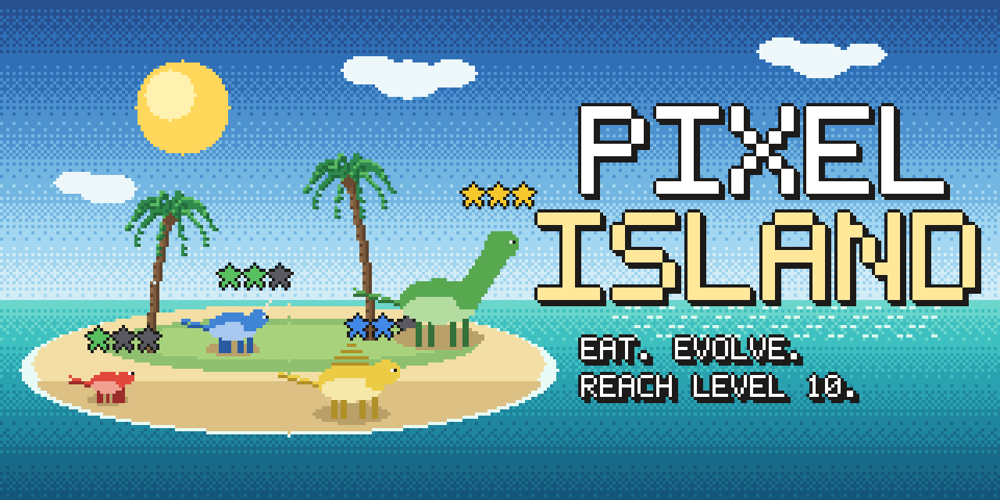

# Pixel Island

Play: https://felix-hwang.github.io/Pixel-Island/

## Overview

Pixel Island is a single-player browser game. You start as a level 1 creature, eat creatures of a lower level, and evolve until you reach level 10. There are 100 species, ten per level, and five maps.

The game has no build step and no dependencies. Its own software renderer draws every creature and map from balls, capsules and boxes, so the only image files are the icons. The music and the sound effects are synthesized by a script in `tools/audio` and stored as MP3. Everything is a static file, and GitHub Pages serves the repository as it is.

The interface is available in Korean, English, Chinese and Malay. It runs on a phone and on a desktop, in portrait and in landscape.

License: [MIT](LICENSE). Made by [Felix](https://github.com/Felix-Hwang).

## Rules

- Touch a creature of a lower level to eat it. When the food gauge is full, you evolve into a random species of the next level.
- Touch a creature of a higher level and the round is over. The camera then follows the creature that ate you.
- Creatures of your own level only push you. AI creatures never eat each other.
- At levels 1 and 2 you can also eat the berries on the ground, because level 1 has nothing lower to eat.
- The food needed to leave a level is the level plus 2.
- Thirty seconds after you reach level 10 the round ends in a win. Every other creature disappears, your creature rises into the sky, and a report lists the map, the play time and each species you played.
- Hunters leave you alone for the first 6 seconds of a round and turn away if they come close.
- You cannot be hurt for a moment after you evolve. When that moment ends, any hunter standing on you is thrown back. The same happens when a root shelter stops protecting you and when you step off the ferry.
- Food from terrain, such as food stalls, clams and the summit flag, fills at most half of a gauge. The rest has to be caught.
- Prey that has fled for 3.5 seconds runs out of breath and slows down.
- The three stars above a creature show its level. Levels 1 to 3 light green stars, 4 to 6 blue, 7 to 9 yellow, and level 10 shows three red stars. Small icons above the stars show the effects it is under.
- Body colour changes only the look.

Species of one level differ in three ways. The field guide in the main menu lists all of them.

| Trait | Values | Effect |
| --- | --- | --- |
| Grade | S, A, B, C, D | A better grade is faster, turns more quickly and has a wider speed margin over hunters and prey. S needs one food fewer and D one more. |
| Detection | short, medium, wide | How far the species notices the player: 4, 5.5 or 7 units. A hunter also has to be on screen before it notices you. |
| Temperament | passive, neutral, aggressive | How far it roams, how early it flees, and how long and how fast it chases. Each map sets its own numbers for the three. |

Around a player, half of the creatures can be eaten, a tenth are equals and up to 40% are hunters. Every time you evolve, the creatures near you walk off and new ones arrive from outside the screen. Hunters are slower than the player, but they come looking for you, some lunge at close range, and a few chase at once. One chases for 10 seconds, then rests for 3. The settings can turn the pursuit off, and then a higher level kills only when you run into it.

## Controls

- Keyboard: the arrow keys or WASD. Hold two keys to move diagonally. The letter keys are read by their position, so they work in any input language.
- Touch or mouse: press anywhere and drag. The point you press becomes the centre of the stick, and letting go stops you.
- Esc leaves a round and goes back to the main menu. So does the exit sign at the top right. In the guide, the settings, the field guide and the map guide, Esc is the Back button.

The settings change the camera view and turn the enemy pursuit, the music and the sound effects on or off. On a small window two camera views would round to the same size, so Near and Far are always kept one step away from Normal.

## Maps

Each round is played on one of five maps, picked at random. The same map never comes twice in a row. A map is 960 by 752 pixels and the camera follows the player. At the border you are pushed back in. The map guide in the main menu shows a picture of each map and explains its effects.

| Map | Id | Terrain effects |
| --- | --- | --- |
| Wave Beach | `beach` | waves, falling coconuts, parasols to hide under, drink stands that speed you up, tide pools |
| Market Street | `market` | food stalls, handcarts, a narrow alley, bouncy awnings, hawkers |
| Current Isles | `islands` | a current, a tide, pearl clams, jellyfish, a ferry |
| Firefly Swamp | `swamp` | fireflies, mud pits, rotten bridges, root shelters, slippery mud |
| Cloud Mountain | `mountain` | clouds to ride, rock walls, fog, high ground, a summit flag |

## Running

Serve the folder with any static file server and open it in a browser.

```bash
python -m http.server 5310
```

Then open http://localhost:5310/.

To publish, set the Pages source of the repository to "GitHub Actions". `.github/workflows/pages.yml` then deploys every push to `main`. `icons/social-preview.png` is the image for the repository's social preview.

Four parameters in the page address set up a test. Each works alone, and a parameter with no value picks at random.

| Parameter | Value | Example |
| --- | --- | --- |
| `map` | a map id | `?map=swamp` |
| `lv` | a starting level, 1 to 10 | `?lv=7` |
| `species` | a species id from `data/species` | `?species=otter` |
| `color` | red, orange, yellow, green, blue, indigo or violet | `?color=blue` |

A species sets its own level, so `species` wins over `lv`. With `?species=` and `?lv=4` together you get a random level 4 species.

Two pages check the data. `tools/silhouette-check.html` compares the outlines of all species, and `tools/i18n-check.html` checks that the four languages have the same keys.

To change a sound, edit `tools/audio/sfx.js` or `tools/audio/bgm.js` and run the build. It needs Node.js and ffmpeg.

```bash
node tools/audio/build.js
```

## Structure

Every file is a plain script that adds to one global object, `PI`. `index.html` sets the load order, and all paths are relative.

The page loads the engine and the species up front. The rest arrives when it is needed, through `src/core/loader.js` and `src/core/audio.js`:

| What | When |
| --- | --- |
| Strings and species names of one language | when that language is chosen |
| One map and its five terrain effects | when that map is put on screen |
| Species facts | when the field guide opens |
| Shared sound effects | after the first key press or touch, because a browser plays no sound before that |
| A map's own sound effects | when that map is put on screen |
| The sounds of the ending | when the player reaches level 9 |
| Music | one track at a time, plus the chase track during a round |

A file that fails to arrive does not stop the game. The page keeps asking for the first map and language until they load. If a later map cannot be fetched, the round is played on the map already on screen. A sound is tried again after 10 seconds.

```
index.html              load order, canvas, status card, dialog
icons/                  favicon and app icons
assets/audio/           9 music tracks and 48 sound effects, as MP3
src/
  core/                 namespace, constants, loader, settings, sound, state, rules, input, frame loop, effects, boot
  gfx/                  renderer: buffers, camera, colour ramps, shapes, shadows, outlines, wind
  creatures/            palette, animation, 15 body templates, senses
  behaviors/            8 movement patterns, one per file
  world/                map baking, plants, props, set pieces, the map list, 5 maps, 25 terrain effects (one per file)
  i18n/                 current language, string lookup, Korean particles
  ui/                   stars, notices, status card, dialog, flags, portraits, transitions, screens
data/
  species/              100 species, one file per level
  speeds.js             speed of every species
  grades.js             grade of every species
  senses.js             detection range of every species
  styles.js             temperament of every species on every map
  i18n/                 interface strings, species names and species facts in four languages
tools/                  the two check pages, and audio/, which writes every sound in assets/audio
```

Where to change things:

| To change | Edit |
| --- | --- |
| The shape and markings of a species | `sil` in `data/species/lvNN.js` |
| Speed, grade, detection or temperament of a species | `data/speeds.js`, `data/grades.js`, `data/senses.js`, `data/styles.js` |
| What a grade, a range or a temperament does | `src/core/config.js`, and `styles` in a map file |
| Difficulty: the share of hunters, how many chase at once, the calm at the start | `levelShare`, `higherShare`, `packLimit`, `closeLimit`, `calm` in `src/core/config.js` |
| Names, facts and interface text | `data/i18n/` |
| A sound or a tune | `tools/audio/sfx.js` or `tools/audio/bgm.js`, then run the build |
| Layout and effect numbers of a map | `src/world/maps/<id>.js` |
| A new body or movement pattern | add one file and one `<script>` line in `index.html` |
| A new map or terrain effect | add the file and list it in `src/world/manifest.js`. A sound heard only on that map goes in `LOCAL` in `src/core/audio.js` |
