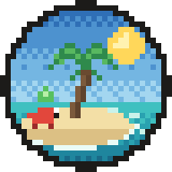

# Pixel Island

Play: https://felix-hwang.github.io/Pixel-Island/

## Overview

Pixel Island is a single-player browser game. You start as a level 1 creature, eat creatures of a lower level, and evolve until you reach level 10. There are 100 species, ten per level.

The game has no build step, no dependencies and no image files for its graphics. Its own software renderer draws every creature and map from balls, capsules and boxes. It runs from static files, so GitHub Pages serves it as it is. The interface is available in Korean, English, Chinese and Malay.

License: [MIT](LICENSE). Made by [Felix](https://github.com/Felix-Hwang).

## Rules

- Touch a creature of a lower level to eat it. When the food gauge is full, you evolve into a random species of the next level.
- Touch a creature of a higher level and the round is over. The camera then follows the creature that ate you.
- Creatures of your own level only push you. AI creatures never eat each other.
- At levels 1 and 2 you can also eat the berries on the ground, because level 1 has nothing lower to eat.
- The food needed to leave a level is the level plus 2.
- Thirty seconds after you reach level 10 the round ends in a win. Every other creature disappears, your creature rises into the sky, and a report lists the map, the play time and each species you played.
- You cannot be hurt for a moment after you evolve.
- The three stars above a creature show its level. Levels 1 to 3 light green stars, 4 to 6 blue, 7 to 9 yellow, and level 10 shows three red stars. Small icons above the stars show the effects it is under.
- Body colour changes only the look.

Species of one level differ in three ways. The field guide in the main menu lists all of them.

| Trait | Values | Effect |
| --- | --- | --- |
| Grade | S, A, B, C, D | A better grade is faster, turns more quickly and has a wider speed margin over hunters and prey. S needs one food fewer and D one more. |
| Detection | short, medium, wide | How far the species notices the player: 4, 5.5 or 7 units. A hunter also has to be on screen before it notices you. |
| Temperament | passive, neutral, aggressive | How far it roams, how early it flees, and how long and how fast it chases. Each map sets its own numbers for the three. |

Hunters are always slower than the player. One chases for 10 seconds, then rests for 3. The settings can turn the chase off, and then a higher level kills only when you run into it.

## Controls

- Keyboard: the arrow keys or WASD. Hold two keys to move diagonally.
- Touch or mouse: press anywhere and drag. The point you press becomes the centre of the stick, and letting go stops you.

The settings change the zoom, the enemy chase, screen shake, the amount of effects, eating notices, the touch stick and vibration.

## Maps

Each round is played on one of five maps, picked at random. The same map never comes twice in a row. A map is 960 by 752 pixels and the camera follows the player. At the border you are pushed back in. The map guide in the main menu shows a picture of each map and explains its effects.

| Map | Id | Terrain effects |
| --- | --- | --- |
| Wave Beach | `beach` | waves, falling coconuts, parasols to hide under, drink stands that speed you up, tide pools |
| Market Street | `market` | food stalls, handcarts, a narrow alley, bouncy awnings, hawkers |
| Current Isles | `islands` | a current, a tide, pearl clams, jellyfish, a ferry |
| Firefly Swamp | `swamp` | fireflies, mud pits, rotten bridges, root shelters, slippery mud |
| Cloud Mountain | `mountain` | clouds to ride, rock walls, fog, high ground, a summit flag |

## Running

Serve the folder with any static file server and open it in a browser.

```bash
python -m http.server 5310
```

Then open http://localhost:5310/.

To publish, enable GitHub Pages for the repository with the source "Deploy from a branch", branch `main`, folder `/ (root)`.

Four parameters in the page address set up a test. Each works alone, and a parameter with no value picks at random.

| Parameter | Value | Example |
| --- | --- | --- |
| `map` | a map id | `?map=swamp` |
| `lv` | a starting level, 1 to 10 | `?lv=7` |
| `species` | a species id from `data/species` | `?species=otter` |
| `color` | red, orange, yellow, green, blue, indigo or violet | `?color=blue` |

A species sets its own level, so `species` wins over `lv`. With `?species=` and `?lv=4` together you get a random level 4 species.

`tools/silhouette-check.html` compares the outlines of all species, and `tools/i18n-check.html` checks that the four language files have the same keys.

## Structure

Every file is a plain script that adds to one global object, `PI`. `index.html` sets the load order, and all paths are relative.

```
index.html              load order, canvas, status card, dialog
icons/                  favicon and app icons
src/
  core/                 namespace, constants, settings, state, rules, input, frame loop, effects, boot
  gfx/                  renderer: buffers, camera, colour ramps, shapes, shadows, outlines, wind
  creatures/            palette, animation, 15 body templates, senses
  behaviors/            8 movement patterns, one per file
  world/                map baking, plants, props, set pieces, 5 maps, 25 terrain effects (one per file)
  i18n/                 current language, string lookup, Korean particles
  ui/                   stars, notices, status card, dialog, flags, portraits, transitions, screens
data/
  species/              100 species, one file per level
  speeds.js             speed of every species
  grades.js             grade of every species
  senses.js             detection range of every species
  styles.js             temperament of every species on every map
  i18n/                 interface strings, species names and species facts in four languages
tools/                  the two check pages
```

Where to change things:

| To change | Edit |
| --- | --- |
| The shape and markings of a species | `sil` in `data/species/lvNN.js` |
| Speed, grade, detection or temperament of a species | `data/speeds.js`, `data/grades.js`, `data/senses.js`, `data/styles.js` |
| What a grade, a range or a temperament does | `src/core/config.js`, and `styles` in a map file |
| Names, facts and interface text | `data/i18n/` |
| Layout and effect numbers of a map | `src/world/maps/<id>.js` |
| A new body, movement pattern or terrain effect | add one file and one `<script>` line in `index.html` |
